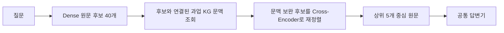

# 과업 KG 기반 RAG

『자주 이기는 제안서』의 수주·영업·제안 업무 지식을 활용하여 질문에 필요한 원문 근거를 검색하고 답변하는 연구입니다. **자이제(Jaije)**는 이 책의 약칭입니다.

## 읽는 순서

1. [평가 완료 방법: Task-KG Context CE](docs/task_kg_context_ce.md)
2. [Aspect 기반 계층 검색 설계: TH-KGR](docs/aspect_hierarchical_retrieval.md)
3. [실험 설정과 결과](results/README.md)
4. [실행 코드 설치·검색 명령](docs/code_usage.md)
5. [데이터셋](../data/jaije_qa_dataset/README.md)

## 방법별 역할

| 방법 | 후보 구성 및 KG 사용 | 이 패키지에 기록된 상태 |
|---|---|---|
| Task-KG Context CE | Dense40을 고정하고 연결된 과업 문맥을 CE 입력에 보완 | 450문항 검색·답변 평가 완료 |
| TH-KGR | Aspect별 과업 선택·계층 탐색으로 후보를 구성하고 원문 CE 적용 | 개발 12문항 후보 구성 및 CE 입력 준비 |
| PARS-RF | 원 질문 Top40과 Aspect별 Top20 합집합을 원문 CE로 재정렬 | 이전 방법; 위 두 방법과 별개 |

현재 메인 테이블의 강조 행은 **Task-KG Context CE**입니다. 이 점수를 새 TH-KGR의 성능으로 사용하지 않습니다. 검색 구현은 `src/task_kg_rag/`에 있으며, 실제 실험 KG의 실행용 스냅샷과 추출 프롬프트를 함께 제공합니다. 모델 가중치·대용량 임베딩·GPU 서버 환경은 포함하지 않습니다. `Ontology/`의 최신 KG 구축 결과와 기존 실험 KG가 동일하다는 보장도 하지 않습니다.

## 전체 구조



최종 답변 근거는 출처를 추적할 수 있는 원문입니다. 과업 설명이나 생성된 KG 문장을 원문 근거로 대체하지 않습니다.

## 코드 빠른 확인

```bash
python -m pip install -e ./Rag
python -m unittest discover -s Rag/tests -v
task-kg-rag --help
```

실제 모델 검색은 [설치·실행 안내](docs/code_usage.md)를 참고하세요. 기존 결과와 코드 정리 후 신규 실행 결과는 구분합니다.
