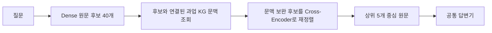

# 과업 KG 기반 RAG

『자주 이기는 제안서』의 수주·영업·제안 업무 지식을 활용하여 질문에 필요한 원문 근거를 검색하고 답변하는 연구입니다. **자이제(Jaije)**는 이 책의 약칭입니다.

## 읽는 순서

1. [평가 완료 방법: Task-KG Context CE](docs/task_kg_context_ce.md)
2. [Aspect 기반 계층 검색 설계: TH-KGR](docs/aspect_hierarchical_retrieval.md)
3. [실험 설정과 결과](results/README.md)
4. [데이터셋](../data/jaije_qa_dataset/README.md)

## 방법별 역할

| 방법 | 후보 구성 및 KG 사용 | 이 패키지에 기록된 상태 |
|---|---|---|
| Task-KG Context CE | Dense40을 고정하고 연결된 과업 문맥을 CE 입력에 보완 | 450문항 검색·답변 평가 완료 |
| TH-KGR | Aspect별 과업 선택·계층 탐색으로 후보를 구성하고 원문 CE 적용 | 개발 12문항 후보 구성 및 CE 입력 준비 |
| PARS-RF | 원 질문 Top40과 Aspect별 Top20 합집합을 원문 CE로 재정렬 | 이전 방법; 위 두 방법과 별개 |

현재 메인 테이블의 강조 행은 **Task-KG Context CE**입니다. 이 점수를 새 TH-KGR의 성능으로 사용하지 않습니다. 이 디렉터리는 방법론·결과·데이터 설명을 정리한 문서 패키지이며, 전체 GPU 실행 환경을 재배포하는 패키지는 아닙니다. `Ontology/`의 최신 KG 구축 결과와 기존 실험 KG가 동일하다는 보장도 하지 않습니다.

## 전체 구조

최종 답변 근거는 출처를 추적할 수 있는 원문입니다. 과업 설명이나 생성된 KG 문장을 원문 근거로 대체하지 않습니다.
