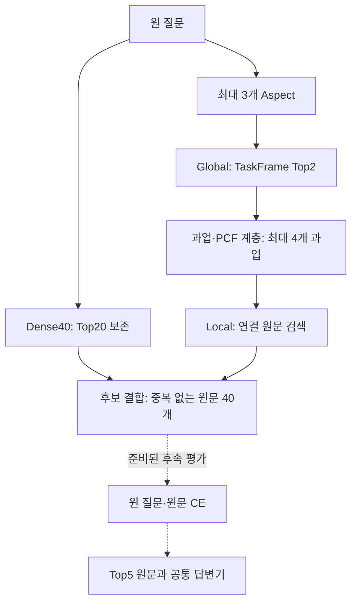

# Task-guided Hierarchical KG Retrieval (TH-KGR)

## 핵심 설계

질문 → Aspect → Global 과업 선택 → 과업·프로세스 계층 탐색 → Local 원문 검색 → 후보 결합 → 원문 재정렬 → 답변.

이 문서는 새 Aspect 기반 검색의 설계를 설명합니다. 현재 패키지에서 확인된 실행 범위는 개발 12문항의 후보 구성 및 CE 입력 준비입니다. 이 방법의 450문항 검색·QA 점수는 제공하지 않습니다.

## 1. 질문만으로 Aspect 추출

Qwen3-8B로 최대 3개의 검색 요구를 추출합니다. 질문의 표현 및 출현 위치와 출력 구조를 확인하고 검색 문자열을 구성합니다. 유효한 결과가 없으면 원 질문을 유지하며 단순 질문의 분해를 강제하지 않습니다. 정답과 근거는 추출 입력에 사용하지 않습니다.

별도 공개 벤치마크의 `depends_on` 계획 및 중간 답 치환은 현재 자이제 구현에서 실행하지 않습니다.

## 2. Global 과업 선택

TaskFrame의 이름·범위·정의를 결합한 설명과 Aspect를 BGE-M3의 정규화된 1,024차원 벡터로 표현합니다. 코사인 유사도로 원문 연결 경로가 있는 상위 2개 과업을 선택합니다. 현재 기록상 전체 12개 과업 중 11개에 원문 경로가 있습니다. 동률은 과업 ID로 처리합니다.

## 3. 타입이 명시된 계층 탐색

- `SUBTASK_OF`: 과업의 직접 부모·자식.
- primary `MAPS_TO_PCF`: 과업과 표준 프로세스의 연결.
- `CHILD_OF`: 프로세스 부모 관계.

동일 프로세스 및 프로세스 부모·그 부모의 자식에 연결된 과업을 살핍니다. 초기 2개 과업은 보존하고 유사도 기준으로 최대 2개를 추가하여 Aspect당 최대 4개로 제한합니다. 일반 관련성·선행 관계를 상하 계층으로 해석하지 않습니다. 현재 Global 순위는 PCF 자체가 아닌 TaskFrame 설명으로 계산합니다.

## 4. Local 원문 검색

선택한 과업에서 원문 정렬 경로로 도달할 수 있는 원문 ID를 모읍니다. 해당 범위 안에서 Aspect와 원문 임베딩의 코사인 유사도로 순위를 매깁니다. KG는 검색 가능한 범위를 정하고 벡터 점수는 그 안의 순서를 정합니다.

## 5. 고정 예산 후보 결합

전체 질문의 Dense40을 별도로 구합니다. 원 질문 Top20을 보존한 뒤 Aspect별 순위에서 round-robin으로 중복 없는 ID를 추가합니다. 부족하면 Dense40의 남은 ID로 보충하여 정확히 40개 후보를 구성합니다. 후보 수가 같아도 Aspect 추출·추가 검색의 계산 비용까지 같아지는 것은 아닙니다.

## 6. 준비된 후속 단계

`bge-reranker-v2-m3`가 원 질문–원문 쌍을 채점합니다. 입력은 최대 512토큰, 질문 prefix는 최대 128토큰입니다. 이 단계에는 과업 설명을 덧붙이지 않습니다. 상위 5개 원문과 공통 답변기로 평가하는 설계이며 최종 실행 조건은 평가 전에 고정해야 합니다.

## 실제 질문과 Aspect 예시

질문 ID: `JAIJE3-QA-0138`

> Executive Summary는 누구를 위해 어떤 목적으로 작성하는 요약본인가요?

실제 저장된 검색 문자열:

1. `Executive Summary 누구를 위해`
2. `Executive Summary 어떤 목적으로`

첫 Aspect의 초기 과업은 **영업 활동 및 관계 구축**, **고객 및 평가자 분석**입니다. PCF 연결을 따라 **제안전략 수립**, **제안서 작성 및 관리**를 추가했습니다. 두 번째 Aspect는 **전술 개발 및 솔루션 최적화**, **영업 활동 및 관계 구축**에서 시작하여 과업·PCF 연결로 범위를 확장했습니다.

이 질문에서 원 질문 Top20을 유지한 최종 후보 40개가 구성되었으며, 원 질문 Dense40 밖에서 19개가 추가되었습니다. 이는 후보 생성 동작의 사례이지 정답 근거 검색 성공 또는 QA 개선의 입증이 아닙니다.

실선은 후보 구성 경로, 점선은 준비된 후속 평가 단계입니다. 최종 그림에서 새 TH-KGR 경로에 기존 Task-KG Context CE의 점수를 붙이지 않습니다.
