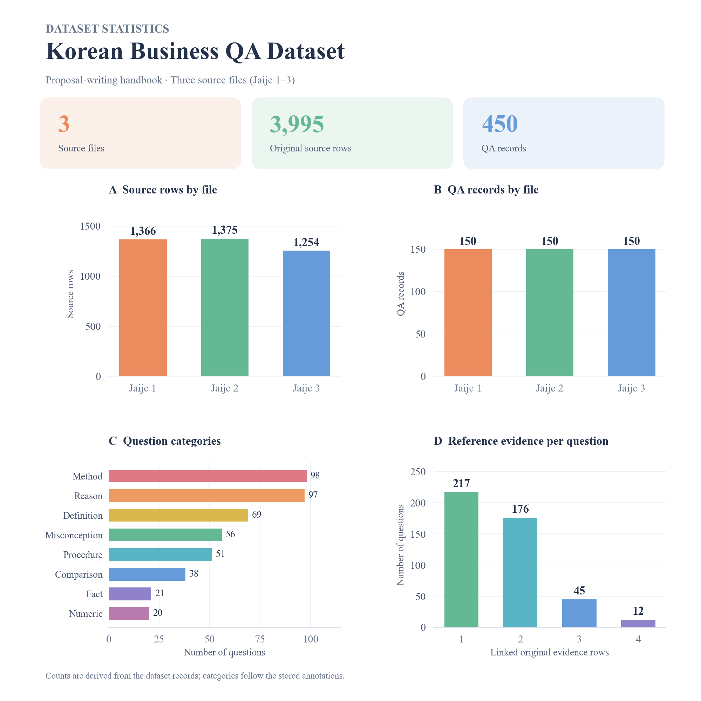

# 『자주 이기는 제안서』 기반 QA 데이터셋

**자이제(Jaije)**는 김용기의 **『자주 이기는 제안서』**를 뜻합니다. 수주·영업·제안 업무를 다루는 이 책을 바탕으로 연구자가 질문·정답·원문 근거를 연결한 데이터셋을 구축했습니다. `자이제_1.xlsx`, `자이제_2.xlsx`, `자이제_3.xlsx`는 로컬 원문 파일의 구분이며 별개의 세 권을 뜻하지 않습니다.

도서 정보: https://www.aladin.co.kr/shop/wproduct.aspx?ItemId=178604312

## 구성

| 파일 | 내용 |
|---|---|
| `upstream/` | 지정한 GitHub 저장소의 원본 데이터·생성 코드·프롬프트·검증 기록 스냅샷 |
| `qa.json` | 450개 질문·참조 답변·출처·근거 ID 및 주석 메타데이터 |
| `corpus.json` | 원문 ID 순서(`ids`)와 원문 정보(`evidence`), 총 3,995행 |
| `evaluation/gold.json` | 질문 ID → 정답 근거 원문 ID |
| `evaluation/split.json` | 질문 ID → dev/test 구분 |
| `statistics.json` | 문서별 규모·질문 유형·근거 수 분포 |
| `provenance.json` | 로컬 원본 해시, 배포 파일 해시 및 원격 접근 상태 |
| `scripts/validate.py` | ID·근거 연결·분할·통계·해시 검증 |

## 규모 및 분할

| 원문 파일 | 원문 행 | 질문 |
|---|---:|---:|
| 자이제_1.xlsx | 1,366 | 150 |
| 자이제_2.xlsx | 1,375 | 150 |
| 자이제_3.xlsx | 1,254 | 150 |
| 합계 | 3,995 | 450 |

개발 150문항과 이전 실험에서 확인한 test 300문항입니다. 전체 450문항 점수는 독립 미사용 최종 시험셋 점수가 아닙니다. 질문 유형은 정의·비교·방법·이유·오개념·수치·사실·절차의 8가지입니다.



## 스키마 및 사용

질문 ID는 `qa_id`, 참조 답변은 `answer`입니다. `source_row_ids`는 원본 파일 내부 행 번호이고, `evidence_ids`는 `J1_ROW_00003`처럼 파일 간 구분이 가능한 원문 ID입니다. 검색 평가에서는 `evidence_ids` 또는 `evaluation/gold.json`을 사용합니다.

원래 QA 파일의 `split=unassigned`를 실험의 별도 split 파일 값으로 정리하고, `evidence_ids`를 추가했습니다. 생성 API 응답 ID만 제외했습니다. 질문·답변·근거 본문은 변경하지 않았으며, `review_status`는 원래 값을 보존했습니다. 모든 문항에 사람 검토가 완료됐다는 의미가 아닙니다.

정답과 정답 근거는 평가용이며 Aspect 추출·온라인 검색 입력에 넣지 않습니다.

```bash
python data/jaije_qa_dataset/scripts/validate.py
```

## 출처 상태

요청된 원격 폴더: https://github.com/ming9oori/AX-seoulfellow/tree/master/jaije_qa_dataset

원격 커밋 `21c91eaaa03854fa1b8288279bfb43ee30a8cf04`을 가져와 `upstream/`에 보존했습니다. 원격 `final_450/qa_dataset.jsonl`과 실험용 `qa.json`의 450개 ID 및 질문·답변·근거 본문·출처 파일·원문 행 번호·질문 유형이 모두 일치합니다. 원본의 미확정 split과 실험에서 사용하는 dev/test 분할은 구분합니다. 책의 원문과 연구자가 구축한 QA 주석의 출처를 구분하며 이 패키지는 별도의 재이용 라이선스를 부여하지 않습니다.

원본 다운로드: [CSV](upstream/final_450/qa_dataset.csv) · [JSONL](upstream/final_450/qa_dataset.jsonl)

생성 과정: [원본 README](upstream/README.md) · [시스템 프롬프트](upstream/jaije2_3/prompts/system_prompt.txt) · [five-shot 예시](upstream/jaije2_3/prompts/few_shot_examples.json)
